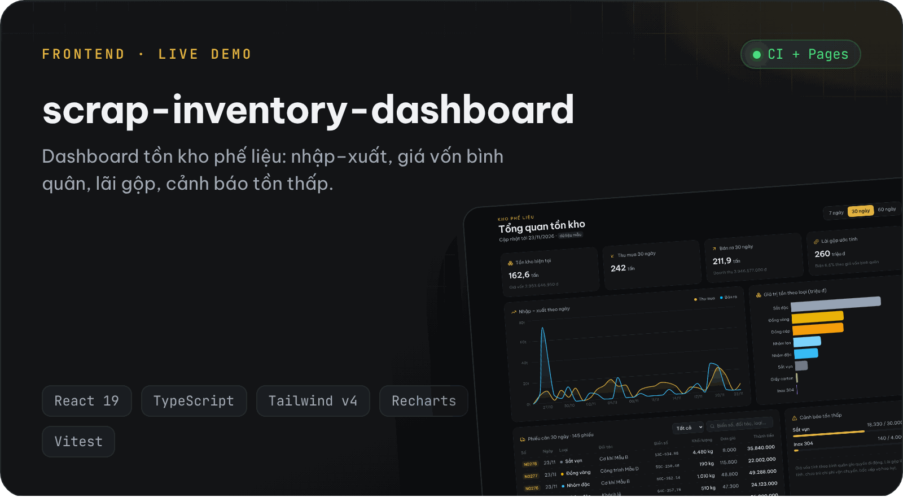
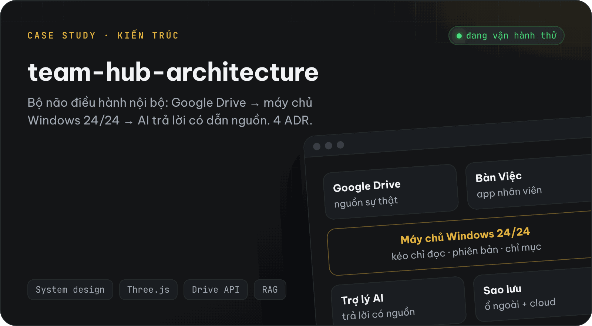
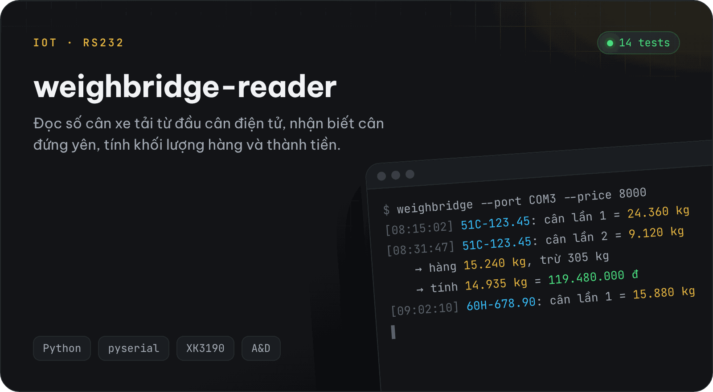
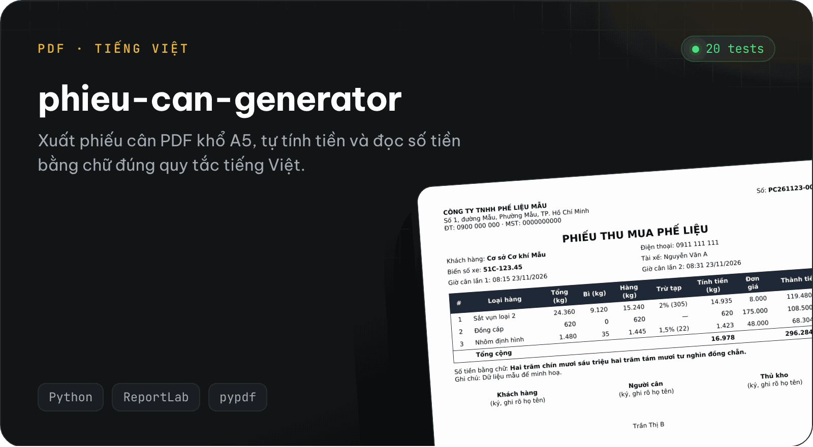
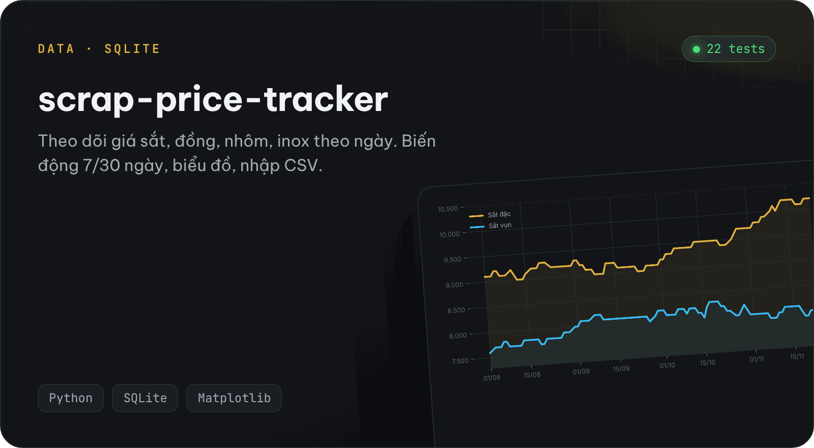
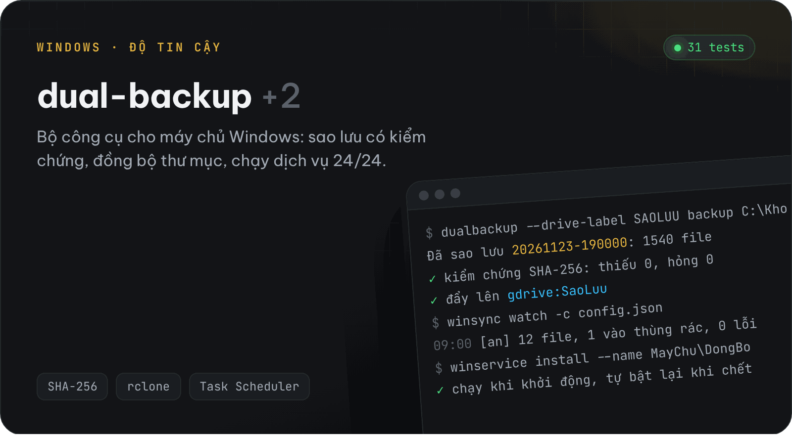

  
  
  

### 👋 Về mình

Frontend developer, làm React, TypeScript và Tailwind, thích giao diện có chuyển động nhưng vẫn dễ dùng ngay từ lần đầu. Hiện là dev duy nhất của **hệ thống điều hành nội bộ tại Bảo Long Scrap**. Mình làm từ giao diện điều hành 3D bằng Three.js, app cho nhân viên, cho tới phần máy chủ Windows chạy 24/24 và AI đọc tài liệu trả lời có dẫn nguồn.

### ✦ Dự án nổi bật

<table>
  <tr>
    <td width="50%"></td>
    <td width="50%"></td>
  </tr>
  <tr>
    <td width="50%"></td>
    <td width="50%"></td>
  </tr>
  <tr>
    <td width="50%"></td>
    <td width="50%"></td>
  </tr>
</table>

Thêm: <a href="https://github.com/ferbdev-byte/win-file-sync">win-file-sync</a> · <a href="https://github.com/ferbdev-byte/win-service-kit">win-service-kit</a> · <a href="https://github.com/ferbdev-byte/angiang-checker">angiang-checker</a> · <a href="https://github.com/ferbdev-byte/portfolio-vnc">portfolio</a>

### ⚙ Stack

   
  

<picture>
  <source media="(prefers-color-scheme: dark)" srcset="https://raw.githubusercontent.com/ferbdev-byte/ferbdev-byte/output/snake-dark.svg"/>
  <source media="(prefers-color-scheme: light)" srcset="https://raw.githubusercontent.com/ferbdev-byte/ferbdev-byte/output/snake.svg"/>
  
</picture>

<!-- AWAKEN:START -->
<!-- AWAKEN:END -->
